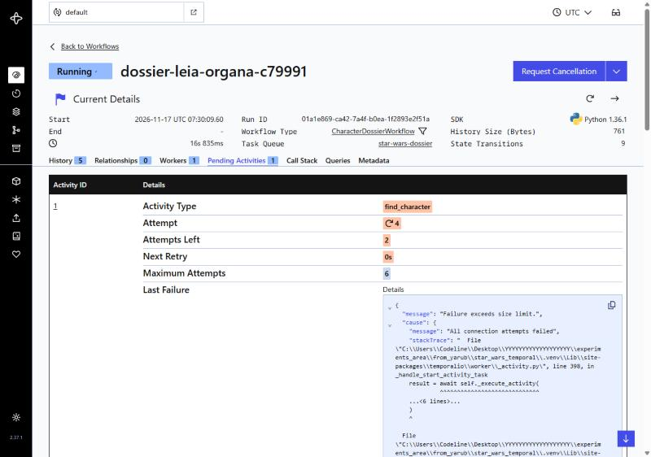
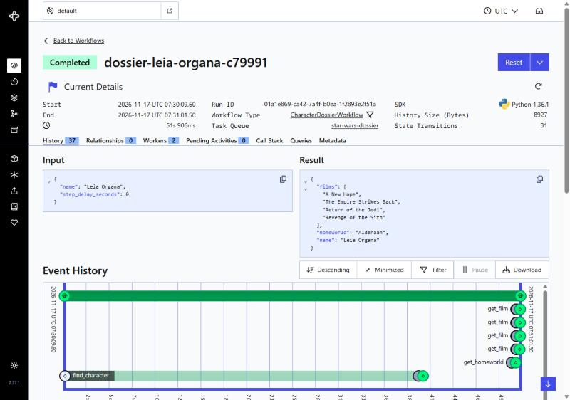
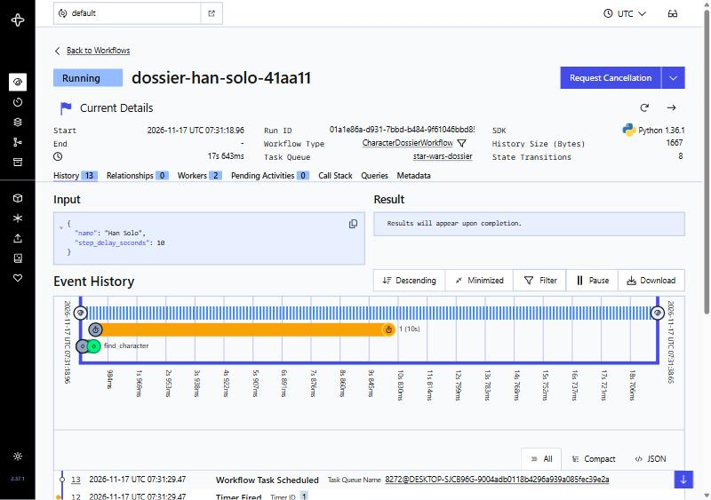
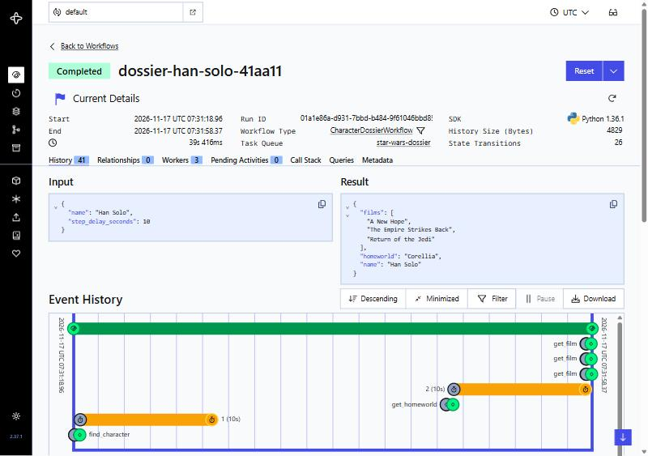

# Star Wars Character Dossier (Temporal + Postgres)

A durable Temporal workflow that builds a character dossier from the Star Wars
API (SWAPI) using dependent requests:
`find_character` → `get_homeworld` → `get_film` (once per film), plus the
optional stretch step `get_species` (only with `--species`).

## Files

| File | Role |
|---|---|
| `docker-compose.yml` | Postgres + Temporal server + Temporal Web UI |
| `.env.example` | Variables to copy into your own git-ignored `.env` |
| `shared.py` | Task queue name, server address, input/output dataclasses |
| `activities.py` | One HTTP request per activity; decides retryable vs non-retryable |
| `workflow.py` | Orders the steps, passes data along, sets the retry policy |
| `worker.py` | Runs the workflow and activity code from the task queue |
| `starter.py` | Starts a workflow and prints the dossier as JSON |

## Run it

```bash
cp .env.example .env          # then set your own POSTGRES_PASSWORD
docker compose up -d          # UI: http://localhost:8080
uv run worker.py              # terminal 1, keep it running
uv run starter.py "Luke Skywalker"   # terminal 2
uv run starter.py "Nobody McNobody"  # fails at once: Character not found
uv run starter.py "Chewbacca" --species   # optional step 4: adds "species": "Wookie"
```

Expected output:

```json
{
  "name": "Luke Skywalker",
  "homeworld": "Tatooine",
  "films": ["A New Hope", "The Empire Strikes Back", "Return of the Jedi", "Revenge of the Sith"]
}
```

`docker compose down` keeps history (named volume `temporal-postgres-data`).
`docker compose down -v` deletes it.

## Proving durability

**Retry test.** Start a worker pointed at a dead address, then start a workflow:

```bash
SWAPI_BASE_URL=http://localhost:9/api uv run worker.py     # broken worker
uv run starter.py "Leia Organa"                             # other terminal
```

In the UI the workflow shows **Pending Activities: find_character**, with the
attempt count rising (1, 2, 3, 4...) and the `ConnectError` as last failure.
Stop the broken worker (Ctrl+C) and start a normal one with `uv run worker.py`.
The *same* workflow continues on its next attempt and completes. In my run,
attempts 1 to 4 failed and attempt 5 succeeded, workflow `dossier-leia-organa-…`.

**Worker-crash test.** Use the step delay so there is time to kill the worker:

```bash
uv run starter.py "Han Solo" --step-delay 10
```

Wait until the worker logs `Searching for 'Han Solo'`, then kill the worker.
Wait a bit, start it again. The restarted worker logs only
`Fetching homeworld ...` and `Fetching film ...`. It never searches for Han
again, because the step-1 result is already in Temporal's history. The starter,
which kept waiting the whole time, prints the dossier.

Screenshots of both tests from the Temporal UI are in
[`docs/screenshots/`](docs/screenshots/).

| Retry: attempt 4 of 6, ConnectError | Retry: completed after the fix |
|---|---|
|  |  |
| **Crash: worker down, workflow waits** | **Crash: completed, find_character ran once** |
|  |  |

## How I used AI

**Tool:** Claude Code, in small steps:
1. "Create a uv project with temporalio and httpx, and a docker-compose with
   Temporal, Postgres and the UI, with health checks and a .env file."
2. "Write one activity per SWAPI request; not-found must be non-retryable."
3. "Write the workflow that chains them with a retry policy, plus worker and starter."
4. "Run it, then do the retry test and the worker-crash test."
5. "Add the optional species step without changing the default output."

**Three things that were wrong or that I changed:**
1. **Dossier key order.** The first version returned a `dict`. The output came back
   as `films, homeworld, name`, because Temporal's JSON converter sorts dict keys.
   I changed the result to a `Dossier` dataclass so the order matches the issue.
2. **`uv init` created a nested `.git` folder** inside the project. Inside the course
   repo, that would make git treat the folder as a separate repository. I deleted
   it, along with the placeholder `main.py`.
3. **"Get all films" as one activity.** That breaks the rule "each activity makes
   one HTTP request". It also means one failed film re-fetches all of them. I split
   it into one `get_film` activity per URL, run in parallel with `asyncio.gather`.
   Also: a 404 on a URL should not be retried, but a plain `raise_for_status()`
   would retry it. `fetch_json` now treats other 4xx as non-retryable and keeps
   5xx/429/network errors retryable.

## What Temporal saved me from

Without Temporal, each of these three dependent requests would need my own retry
loop with sleeps and a backoff. I would also need to save the progress myself
(a file or a database table), so a crash halfway through would not mean starting
again from request 1. And I would need code to tell "try again later" errors
apart from "give up now" errors. With Temporal, the retry policy is a few lines.
Every finished step is written to Postgres automatically. When the worker died
in the crash test, the restarted worker picked up exactly where it stopped,
without searching for the character again. The only thing I had to decide was
which errors are permanent (character not found) and mark them non-retryable.
