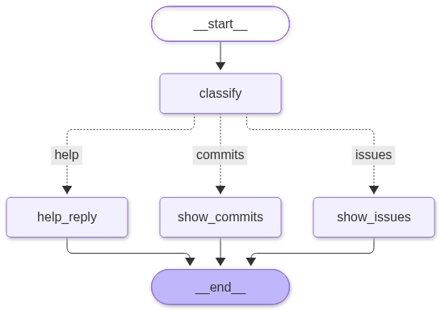

# Repo Explorer: LangGraph Branching + GitHub MCP Server

Beginner practice for issue **#315**. A small workflow answers questions about a
public GitHub repository by calling the GitHub MCP server.

## What goes in this folder

| File | Purpose |
| --- | --- |
| `explore_tools.py` | Step 1: connect to the GitHub MCP server, list tools, call one |
| `github_tools.py` | Step 2: `get_open_issues` and `get_recent_commits` async helpers |
| `repo_graph.py` | Step 3: LangGraph workflow with classify + conditional branching |
| `repo_graph.png` | Diagram saved by `draw_mermaid_png()` |

## Setup

Python 3.14, dependencies already installed with `uv`.

1. Put your token in `.env` (this file is git-ignored):

   ```env
   GITHUB_TOKEN=github_pat_...
   ```

   Use a fine-grained personal access token with **read-only** access to public
   repositories. `.env.example` shows the shape; never commit `.env`.

2. Sync the environment if you move to another machine:

   ```bash
   cd experiments_area/from_Louai/repo_explorer
   uv sync
   ```

3. Select the `.venv` interpreter in VS Code (`Python: Select Interpreter` -> `./.venv`).

## Run

Run from inside this folder, so `load_dotenv()` finds `.env`:

```bash
uv run explore_tools.py   # lists the GitHub MCP tools and calls list_issues
uv run github_tools.py    # tests the two helpers on their own
uv run repo_graph.py      # saves repo_graph.png and runs the 4 questions
```

## How it works

`classify` sets `kind` from the question (plain Python, no LLM). The decider
`route_by_kind` returns that `kind`, and `add_conditional_edges` maps it to one of
three nodes: `show_issues`, `show_commits` or `help_reply`. The first two call the
helpers in `github_tools.py`, which use the FastMCP client in four steps:
connect, list tools, call a tool, read the result.

Note: the GitHub MCP server expects `owner` and `repo` as extra request headers, and
the client only adds them after `list_tools()` has read the schema. That is why each
helper calls `list_tools()` before `call_tool()`.



## My four questions and answers

From the run on 2026-11-26 against `CodelineAtyab/CodelineLegendsAIWorkflows`:

| Question | Branch | Answer |
| --- | --- | --- |
| Show open issues | issues | `#315 Beginner Practice: Repo Explorer ...`, `#314 Clinic Assistant v2 ...`, `#306 Clinic Booking Assistant ...`, `#175 ...`, `#142 ...` |
| What are the latest commits? | commits | `1133f4e Added QDRANT docker compose and 2 langgraph worklfows for RAG`, `f5e941b Added License`, `fca5469 Added Docker Compose to Spin up Temporal`, `40c8d3f ...`, `9607e3e ...` |
| Any new issue today? | issues | Same five open issues as above |
| Hello | help | `Ask me about issues or commits.` |
