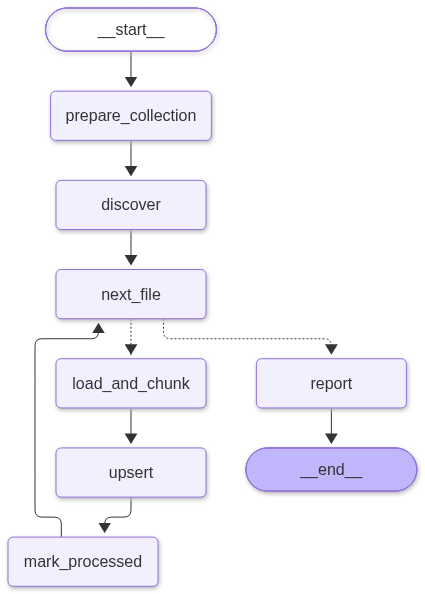
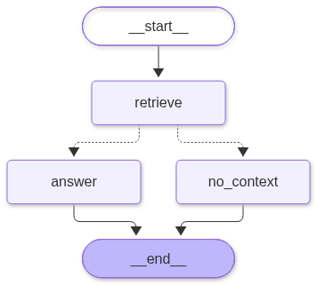

# Qdrant RAG Workflow

Two small LangGraph demos that show the whole retrieval-augmented generation
loop end to end: put PDFs into a vector database, then answer customer
questions from them with citations.

| Workflow | What it does | Model |
| --- | --- | --- |
| **1. Ingest** | Reads every unprocessed `.pdf`, splits it into 1000-token chunks (200 overlap), embeds them and writes them to Qdrant | `text-embedding-3-small` |
| **2. Query** | Embeds the question, retrieves the closest chunks, and answers using only those chunks | `gpt-4.1-mini` |

Qdrant runs in Docker (`docker/docker-compose.yml`); the Python side is a
normal [uv](https://docs.astral.sh/uv/) project. Neither workflow talks to the
database until it actually runs, so the graph diagrams can be rendered offline.

## The graphs

Both graphs are compiled with LangGraph and kept as committed images, so you can
read them without running anything.

### 1. Ingest (`qdrant_rag/ingest_workflow.py`)



The loop processes one file at a time. `load_and_chunk` reads the PDF with
`pypdf` and splits each page into chunks; `upsert` embeds them; `mark_processed`
renames the file with a leading underscore. A failure anywhere in the middle is
recorded and the loop moves on to the next file.

### 2. Query (`qdrant_rag/query_workflow.py`)



`retrieve` asks Qdrant for the top chunks above the similarity threshold. If
nothing relevant comes back, the conditional edge sends the run to
`no_context` instead of letting the model invent an answer.

## How "already processed" works

There is no extra state file: **the filesystem is the ledger**.

```
data/pdfs/report.pdf      # not ingested yet
data/pdfs/_report.pdf     # ingested successfully, skipped next time
```

- A file is renamed only after its chunks are stored, so a crash or a missing
  API key leaves it untouched and it is retried on the next run.
- Name collisions are handled: if `_report.pdf` already exists the new one
  becomes `_report-1.pdf`.
- `--recreate` drops the collection first, so it also re-reads the marked
  files - otherwise "reset the database" would quietly lose them.
- Chunk ids are deterministic (`collection:file:page:chunk`), so re-ingesting
  the same file updates the existing points instead of duplicating them.

## Layout

```
qdrant_rag_workflow/
├── main.py                     # CLI: ingest | query | graphs
├── sample.env                  # copy to .env and add your OpenAI key
├── docker/
│   ├── docker-compose.yml      # Qdrant v1.20.2, data in docker/qdrant_storage
│   └── README.md               # start/stop/wipe recipes
├── data/pdfs/                  # your PDFs (created on first ingest, gitignored)
└── qdrant_rag/
    ├── config.py               # Settings from environment / .env
    ├── clients.py              # lazy Qdrant + OpenAI clients
    ├── ingest_workflow.py      # workflow 1
    ├── query_workflow.py       # workflow 2
    ├── prompts.py              # grounded-answer prompt
    ├── graph_utils.py          # writes the .png/.mmd diagrams
    └── *.png, *.mmd            # committed graph diagrams
```

## Quickstart

```bash
cd experiments_area/from_atyab/qdrant_rag_workflow

# 1. Python dependencies (creates .venv from uv.lock)
uv sync

# 2. Configuration
cp sample.env .env        # then paste your key into OPENAI_API_KEY

# 3. Vector database
docker compose -f docker/docker-compose.yml up -d
curl http://localhost:6333/healthz      # -> healthz check passed

# 4. Drop PDFs in data/pdfs (created automatically) and ingest them
mkdir -p data/pdfs
cp ~/Downloads/handbook.pdf data/pdfs/
uv run python main.py ingest

# 5. Ask questions
uv run python main.py query "How long do refunds take?"
```

Expected ingest output:

```
  created collection 'pdf_knowledge' (size=1536, distance=cosine)

Ingest from .../data/pdfs
  found 1 PDF(s), 1 to process, 0 already marked

[1] handbook.pdf
  12 page(s) -> 87 chunk(s)
  stored 87 chunk(s) in 'pdf_knowledge'
  marked as _handbook.pdf

Ingest summary
  processed: 1 PDF(s), 87 chunk(s)
  skipped (already marked): 0
  failed: 0
  collection: 'pdf_knowledge' at http://localhost:6333
```

And a query:

```
Retrieved 4 chunk(s) for: 'How long do refunds take?'
  0.612  _handbook.pdf p.7
  0.588  _handbook.pdf p.8
  ...

Answer
------
Refunds are processed within 5 business days of approval [handbook.pdf p.7].

Sources
  - _handbook.pdf p.7
  - _handbook.pdf p.8
```

## Commands

| Command | Purpose |
| --- | --- |
| `uv sync` | Install the locked dependencies into `.venv` |
| `docker compose -f docker/docker-compose.yml up -d` | Start Qdrant |
| `docker compose -f docker/docker-compose.yml down` | Stop Qdrant (vectors are kept) |
| `uv run python main.py ingest` | Ingest new PDFs |
| `uv run python main.py ingest --include-processed` | Re-ingest `_`-marked files too |
| `uv run python main.py ingest --recreate` | Drop the collection and rebuild it from every PDF |
| `uv run python main.py query "..."` | Ask one question |
| `uv run python main.py query --interactive` | Ask questions until an empty line |
| `uv run python main.py query "..." --top-k 8` | Retrieve more chunks for one question |
| `uv run python main.py graphs` | Rewrite the four diagram files |

`ingest` exits with `1` when at least one file failed (those files stay
unmarked), `0` otherwise. The error and exit-code conventions follow the other
projects in this repository.

## Configuration

All settings come from `.env` (see `sample.env`); real environment variables
win over the file.

| Variable | Default | Meaning |
| --- | --- | --- |
| `OPENAI_API_KEY` | - | **Required.** Used by both workflows |
| `OPENAI_CHAT_MODEL` | `gpt-4.1-mini` | Model that writes the answer |
| `OPENAI_EMBEDDING_MODEL` | `text-embedding-3-small` | Model that embeds chunks and questions |
| `OPENAI_EMBEDDING_DIMENSIONS` | `1536` | Must match the collection |
| `QDRANT_URL` | `http://localhost:6333` | REST endpoint of the container |
| `QDRANT_API_KEY` | empty | Only for Qdrant Cloud / secured instances |
| `QDRANT_COLLECTION` | `pdf_knowledge` | Collection name |
| `PDF_DIR` | `data/pdfs` | Where the ingest workflow looks (relative to the project root) |
| `CHUNK_SIZE_TOKENS` | `1000` | Chunk size in **tokens** (`cl100k_base`) |
| `CHUNK_OVERLAP_TOKENS` | `200` | Overlap in tokens |
| `RETRIEVAL_TOP_K` | `4` | Chunks sent to the chat model |
| `RETRIEVAL_SCORE_THRESHOLD` | `0.2` | Cosine cut-off; below it the answer is "not found" |

Changing the embedding model (or `OPENAI_EMBEDDING_DIMENSIONS`) requires
`ingest --recreate`, because the collection's vector size is fixed.

## Tests and quality checks

There is no test suite yet; the project is verified by running both workflows
against the container. The CI checks are:

```bash
uvx ruff@0.16.10 check .                                    # lint (same version as CI)
uv run --frozen --with 'mypy==2.4.0' mypy --ignore-missing-imports .
uvx ruff@0.16.10 format .                                   # optional formatting
```

## Troubleshooting

| Symptom | Fix |
| --- | --- |
| `Cannot reach Qdrant at http://localhost:6333` | `docker compose -f docker/docker-compose.yml up -d` |
| `OPENAI_API_KEY is not set` | `cp sample.env .env`, paste the key |
| `Could not search collection ... 404` | `uv run python main.py ingest` first |
| `Collection 'pdf_knowledge' stores N-dim vectors but ...` | Run ingest with `--recreate` |
| A file keeps failing | It stays unmarked by design; check the error in the summary (scanned PDFs have no text layer) |
| Answers say "could not find" | Lower `RETRIEVAL_SCORE_THRESHOLD`, raise `RETRIEVAL_TOP_K`, or add the relevant PDF |

## Notes

- Everything is synchronous and single-process; this is a teaching demo, not a
  production service.
- Ingest costs one embedding call per chunk batch (64 chunks per request) and
  no chat tokens. Each query costs one embedding call plus one chat call.
- The prompt tells the model to cite `[file.pdf p.N]` and to refuse when the
  context is empty. Keep that behaviour when editing `prompts.py`.
