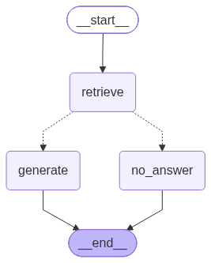

# Clinic Booking Assistant (RAG with LangGraph and Qdrant)

Issue #306. A customer of a clinic asks a question and gets an answer based only on the clinic's own PDF documents.

```
INGEST   PDF ──► chunks ──► embeddings ──► Qdrant          (ingest.py, run once)

ANSWER   question ──► retrieve ──► generate  ──► answer    (clinic_rag.py, per question)
                            └────► no_answer ─┘
```

All clinic data in `sample_pdfs/` is made up (the fictional "Sunrise Family Clinic").

## Files

| File | What it does |
|---|---|
| `ingest.py` | Reads each PDF, splits it into overlapping chunks, embeds them with `text-embedding-3-small`, and stores them in the Qdrant collection `clinic_docs` |
| `clinic_rag.py` | LangGraph workflow: `retrieve` → (decider) → `generate` with `gpt-4.1-mini`, or `no_answer`; runs 5 test questions |
| `clinic_rag.png` | Diagram of the graph, saved by `clinic_rag.py` |
| `sample_pdfs/` | `opening_hours.pdf`, `services_and_prices.pdf`, `booking_policy.pdf` |
| `.env.example` | Template for the API key (the real `.env` is ignored by git) |
| `docs/clinic_rag_design.html` | Interactive design page: data flow, steps, how to run |

## The graph



| Node | Reads | Writes | Job |
|---|---|---|---|
| `retrieve` | `question` | `chunks` | Embed the question, search Qdrant, keep up to 3 chunks with a score of at least `RELEVANCE_THRESHOLD` |
| `generate` | `question`, `chunks` | `answer` | Ask `gpt-4.1-mini` to answer using only the chunks |
| `no_answer` | nothing | `answer` | Return a polite "please contact the clinic" message |

`decide_next_step` returns `"generate"` when at least one chunk was found, otherwise `"no_answer"`.

## How to run

Everything runs in PowerShell from this folder (`experiments_area\from_mabri\clinic_rag`). You need Docker Desktop running and an OpenAI API key.

### 1. One-time setup

```powershell
uv sync
Copy-Item .env.example .env
```

Open `.env` and replace `your-key-here` with your OpenAI key. Never commit `.env`.

### 2. Start Qdrant locally

```powershell
docker run -d --name clinic-qdrant -p 6333:6333 -v qdrant_storage:/qdrant/storage qdrant/qdrant
```

If the container already exists, use `docker start clinic-qdrant` instead. Dashboard: http://localhost:6333/dashboard

### 3. Load the PDFs into Qdrant

```powershell
uv run ingest.py
```

Expected output:

```
booking_policy.pdf: 3 chunks stored
opening_hours.pdf: 2 chunks stored
services_and_prices.pdf: 2 chunks stored
```

Each run starts from an empty `clinic_docs` collection, so it is safe to run again after changing a PDF.

### 4. Ask the test questions

```powershell
uv run clinic_rag.py
```

It saves `clinic_rag.png`, then prints the final state (`question`, `chunks`, `answer`) for each test question.

### 5. Stop and clean up

```powershell
docker stop clinic-qdrant
docker rm clinic-qdrant
docker volume rm qdrant_storage
```

Run only the first line to pause. The last line deletes the stored vectors.

## Test questions and answers

> TODO: fill in from the first real run of `uv run clinic_rag.py` (waiting for the OpenAI API key).

| # | Question | Expected source | Branch | Answer |
|---|---|---|---|---|
| 1 | What time do you open on Friday? | `opening_hours.pdf` | generate | _pending_ |
| 2 | Do you accept walk-ins? | `booking_policy.pdf` | generate | _pending_ |
| 3 | How do I cancel an appointment? | `booking_policy.pdf` | generate | _pending_ |
| 4 | How much is a dental check-up? | `services_and_prices.pdf` | generate | _pending_ |
| 5 | Do you sell car insurance? | none | no_answer | _pending_ |

## Settings

All settings are named constants at the top of each script:

| Constant | Value | Where |
|---|---|---|
| `EMBEDDING_MODEL` | `text-embedding-3-small` (1536 numbers per vector) | both scripts, must match |
| `CHAT_MODEL` | `gpt-4.1-mini` | `clinic_rag.py` |
| `COLLECTION_NAME` | `clinic_docs` | both scripts |
| `CHUNK_SIZE` / `CHUNK_OVERLAP` | 500 / 100 characters | `ingest.py` |
| `TOP_K` | 3 | `clinic_rag.py` |
| `RELEVANCE_THRESHOLD` | 0.4 (cosine similarity) | `clinic_rag.py` |

## Troubleshooting

| Problem | Fix |
|---|---|
| `OpenAIError: Missing credentials` | `.env` is missing or still has `your-key-here` |
| `Connection refused` on port 6333 | Qdrant isn't running: `docker start clinic-qdrant` |
| `Collection clinic_docs not found` | Run `uv run ingest.py` before `clinic_rag.py` |
| An answer looks made up | Print `chunks` first: usually retrieval is the problem, not the model |
| A clinic question gets the no-answer message | `RELEVANCE_THRESHOLD` is too high for that question; lower it slightly |
