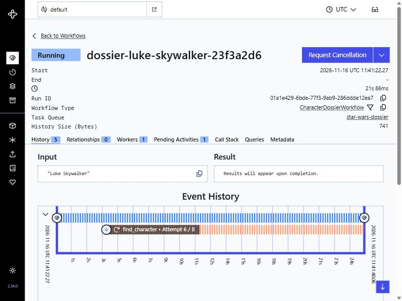
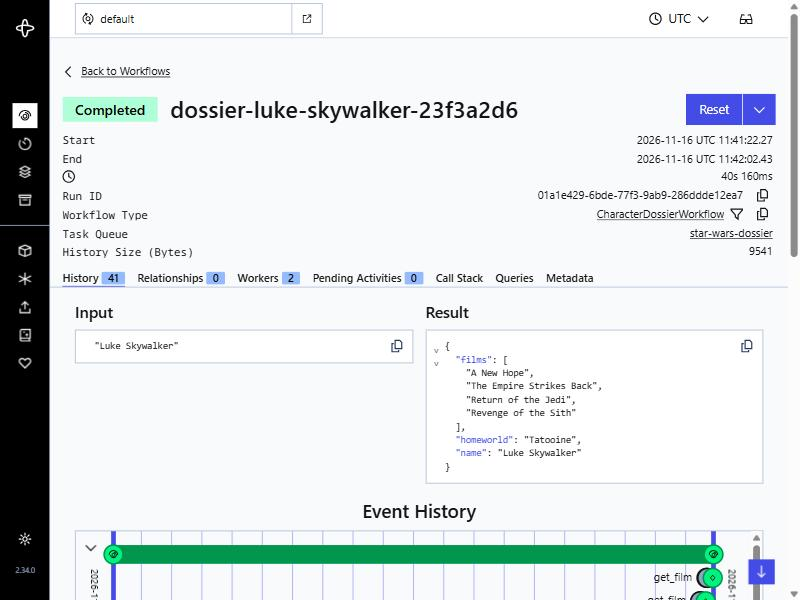
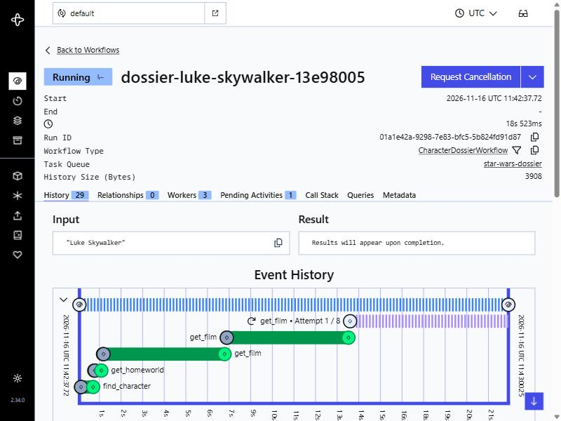
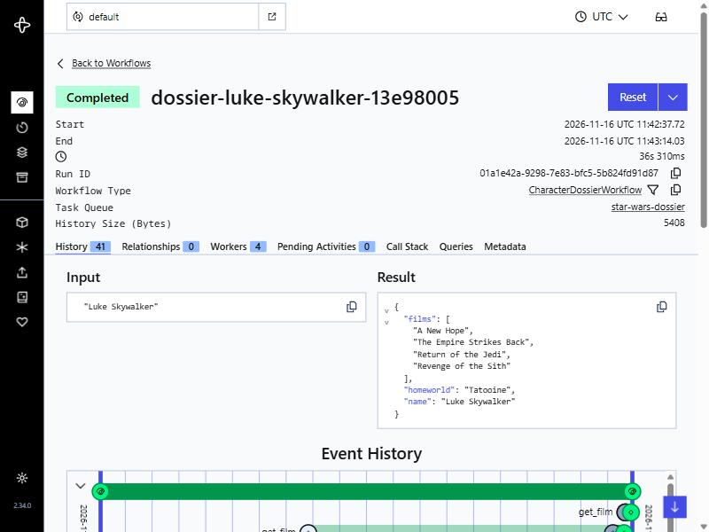

# Durability tests

Both tests were run on 2026-11-16 against the local stack from `docker-compose.yml`.
The test switches (`SWAPI_BASE_URL`, `SLOW_FILM_SECONDS`) are environment
variables read by `activities.py`, so no code had to be edited to run them.

## 1. Retry test: a broken step is retried, then fixed without restarting the workflow

**Steps**

1. Started a worker pointed at a host that does not exist:
   `$env:SWAPI_BASE_URL='https://swapi.invalid/api'; uv run worker.py`
2. Started the workflow: `uv run starter.py "Luke Skywalker"`
   (workflow ID `dossier-luke-skywalker-23f3a2d6`).
3. Each `find_character` attempt failed with a connection error, and Temporal
   retried with a growing delay (1s, 2s, 4s, 8s, 16s...).
4. At attempt 6 of 8, stopped the broken worker and started a normal one
   (`uv run worker.py`). The workflow itself was **not** restarted: same ID,
   same run.
5. The next retry landed on the fixed worker, and the starter, still waiting,
   printed the dossier.

**Evidence**

The UI while retrying shows `find_character • Attempt 6 / 8` and "Next Retry 16s":

The same workflow, completed, with the full dossier as its result:

Attempts recorded in the history (`temporal workflow show`):

| Activity | Attempt that succeeded |
|---|---|
| find_character | **6** (attempts 1-5 failed on the broken host) |
| get_homeworld | 1 |
| get_film x4 | 1 each |

## 2. Worker-crash test: a killed worker does not redo finished steps

**Steps**

1. Started a worker that pauses 6s inside each film step, which gives time to kill it:
   `$env:SLOW_FILM_SECONDS='6'; uv run worker.py`
2. Started the workflow: `uv run starter.py "Luke Skywalker"`
   (workflow ID `dossier-luke-skywalker-13e98005`).
3. Once the history showed 2 completed `get_film` steps, force-killed the
   worker process (`Stop-Process -Force`, which works like a crash: no clean shutdown).
4. Started a fresh normal worker (`uv run worker.py`).
5. After film 3's 15s `start_to_close_timeout` ran out, Temporal gave that
   step to the new worker, and the workflow completed.

**Evidence**

After the kill, steps 1-2 and two films are done (green), and film 3 is stuck on the dead worker:

Completed after the new worker took over:

The history shows which worker process ran each step:

| Activity | Attempt | Worker (PID) |
|---|---|---|
| find_character | 1 | 17808 (killed) |
| get_homeworld | 1 | 17808 (killed) |
| get_film (A New Hope) | 1 | 17808 (killed) |
| get_film (Empire Strikes Back) | 1 | 17808 (killed) |
| get_film (Return of the Jedi) | **2** | 23540 (new) |
| get_film (Revenge of the Sith) | 1 | 23540 (new) |

Each activity type was scheduled exactly as often as it is needed
(`find_character` 1, `get_homeworld` 1, `get_film` 4). The new worker did
**not** repeat the search, the homeworld, or the first two films. It only
retried the one film that was in flight when the worker died.

## Open question

In the retry test, the history stored the last connection error as
"Failure exceeds size limit." instead of the real message. That message does
not come from the Python SDK's own code. It is most likely the long chain of
httpx/httpcore errors (with stack traces) being cut off by Temporal, but this
has not been confirmed yet.
